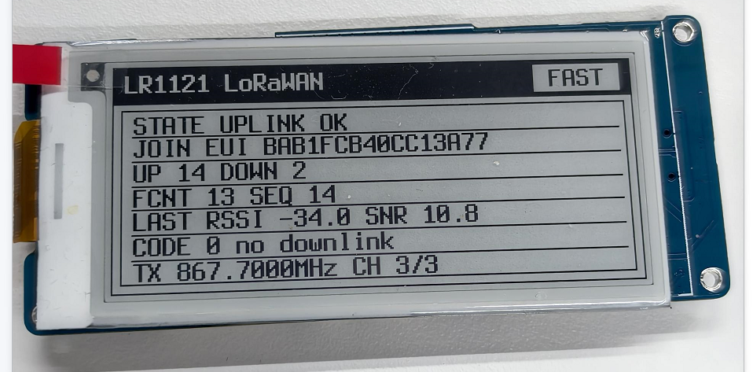
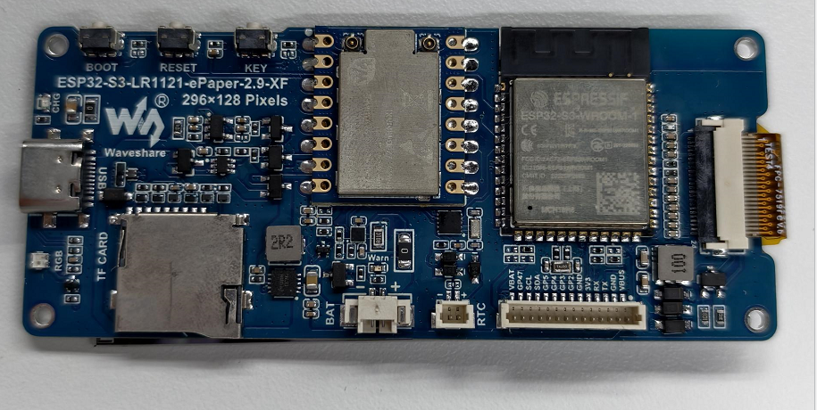

# ESP32-S3-LR1121-ePaper-2.9

[English](README.md)

本仓库整理了 Waveshare ESP32-S3-LR1121-ePaper-2.9（产品版本
1.0.0）的 ESP-IDF 示例、Arduino 示例、产品图片和硬件资料。

## 当前状态

本轮仅整理仓库结构，没有改写示例功能代码。CI 与固件打包配置已准备
用于远程仓库审核，但本轮没有执行编译、CI、烧录或实板测试。

当前原理图仍位于待审目录，因为其中一个电子纸连接器标注与图纸产品
标题不一致。尺寸图和工厂恢复固件已预留位置，待后续资料补齐。

## 快速入口

- 中文 Wiki：[`docs/wiki.zh-CN.md`](docs/wiki.zh-CN.md)
- 硬件事实清单：[`docs/hardware-facts.zh-CN.md`](docs/hardware-facts.zh-CN.md)
- 官网详情页预览：[`web/product-detail/`](web/product-detail/)
- ESP-IDF 项目：[`examples/esp-idf/`](examples/esp-idf/)
- Arduino 示例和随仓库库文件：[`examples/arduino/`](examples/arduino/)
- 硬件资料：[`hardware/`](hardware/)
- CI 说明：[`docs/ci.md`](docs/ci.md)
- 固件打包：[`releases/`](releases/)

每个编号目录都是独立示例。构建或烧录前，请先阅读对应框架和示例目录
中的 README。

当前 Wiki 和详情页按“已确认 / 实现参考 / 用户提供待复测 / 待确认”管理
规格。用户提供的“低于 12 µA”仅作为特定条件下的阶段性目标或实测信息，
在补齐固件、供电、测量点、仪表和环境条件前不作为无条件产品保证。

## 示例

| 编号 | ESP-IDF | Arduino | 功能 |
| --- | --- | --- | --- |
| 01 | `01_ws2812_led` | `01_ws2812_led` | 板载 WS2812 |
| 02 | `02_i2c_scan` | `02_i2c_scan` | I2C 设备扫描 |
| 03 | `03_epaper_2_9` | `03_epaper` | 2.9 英寸电子纸 |
| 04 | `04_bat_axp2602` | `04_bat_axp2602` | AXP2602 电量计 |
| 05 | `05_rtc_pcf85063` | `05_rtc_pcf85063` | PCF85063A RTC |
| 06 | `06_lr1121_pingpong` | `06_lr1121_pingpong` | LR1121 Ping-Pong |
| 07 | `07_deep_sleep` | `07_deep_sleep` | 深度睡眠 |
| 08 | `08_comprehensive_demo` | `08_comprehensive_demo` | 综合示例 |
| 09 | `09_lr1121_lorawan` | `09_lr1121_lorawan` | LoRaWAN Class A OTAA |
| 10 | `10_LoRaWAN_ABP` | `10_LoRaWAN_ABP` | LoRaWAN Class A ABP |
| 11 | `11_LoRaWAN_Class_C` | `11_LoRaWAN_Class_C` | LoRaWAN Class C |
| 12 | `12_LoRaWAN_Multicast` | `12_LoRaWAN_Multicast` | LoRaWAN 组播 |

LoRaWAN 示例使用占位凭据。启用射频通信前必须按部署地区确认区域、
频率计划、天线和发射功率，并配置有效凭据。不得把真实密钥提交到源码
或支持日志中。

## CI 与 Releases

GitHub Actions 工作流会动态发现直接位于示例目录下的一方项目，当前
配置矩阵为 ESP-IDF v5.5.5、ESP-IDF v6.0.2 和 Arduino-ESP32 3.3.11。
成功构建后，工作流计划生成可直接烧录的 ZIP，其中包含 manifest、
SHA-256 校验值、原始分段、合并固件以及 Windows/POSIX 烧录脚本。
推送 `v*` 标签时，工作流计划将这些包发布到 GitHub Releases。

在真实远程仓库运行之前，这些配置仅通过静态检查。CI 编译通过也不能
替代射频、电子纸、电源、休眠、时序或其他实板验证。

## 许可证

原创代码使用 Apache-2.0；原创图片、文档、原理图及硬件资料使用
CC BY 4.0。嵌套的第三方许可证继续优先适用。详见
[`LICENSES/README.md`](LICENSES/README.md) 和
[`THIRD_PARTY_NOTICES.md`](THIRD_PARTY_NOTICES.md)。
