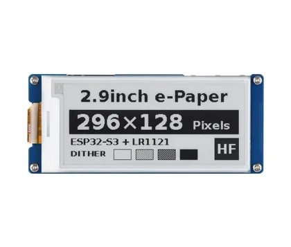

# ESP32-S3-LR1121-ePaper-2.9

[English](README.md)

本仓库提供 Waveshare ESP32-S3-LR1121-ePaper-2.9 的 ESP-IDF 示例、
Arduino 示例和硬件资料。

## 快速入口

- ESP-IDF 项目：[`examples/esp-idf/`](examples/esp-idf/)
- Arduino 示例和随附库：[`examples/arduino/`](examples/arduino/)
- 硬件资料：[`hardware/`](hardware/)
- CI 说明：[`docs/ci.md`](docs/ci.md)
- 固件打包工具：[`releases/`](releases/)

每个编号目录包含一个示例项目。所有 ESP-IDF 示例均通过
`waveshare/waveshare_boards` 使用 `esp_board_manager`。编译前请按
[板型准备说明](examples/esp-idf/README.md#board-manager-integration)生成板级配置。

Arduino 用户将 IDE 的“项目文件夹位置”设置为本仓库的 `examples/arduino`
目录，重启 IDE 后即可使用随附库。具体配置和操作见所选示例的 README。

## 示例

| 编号 | ESP-IDF | Arduino | 功能 |
| --- | --- | --- | --- |
| 01 | `01_ws2812_led` | `01_ws2812_led` | 板载 WS2812 |
| 02 | `02_i2c_scan` | `02_i2c_scan` | I2C 设备扫描 |
| 03 | `03_epaper_2_9` | `03_epaper` | 2.9 英寸电子纸 |
| 04 | `04_bat_axp2602` | `04_bat_axp2602` | AXP2602 电量计 |
| 05 | `05_rtc_pcf85063` | `05_rtc_pcf85063` | PCF85063A RTC |
| 06 | `06_lr1121_pingpong` | `06_lr1121_pingpong` | LR1121 Ping-Pong |
| 07 | `07_sd_card` | `07_sd_card` | microSD 1-bit SDMMC 读写测试与墨水屏状态显示 |
| 08 | `08_deep_sleep` | `08_deep_sleep` | 深度睡眠 |
| 09 | `09_comprehensive_demo` | `09_comprehensive_demo` | 综合示例 |
| 10 | `10_lr1121_lorawan` | `10_lr1121_lorawan` | LoRaWAN Class A OTAA |
| 11 | `11_LoRaWAN_ABP` | `11_LoRaWAN_ABP` | LoRaWAN Class A ABP |
| 12 | `12_LoRaWAN_Class_C` | `12_LoRaWAN_Class_C` | LoRaWAN Class C |
| 13 | `13_LoRaWAN_Multicast` | `13_LoRaWAN_Multicast` | LoRaWAN 组播 |

运行 LoRaWAN 示例前，请在配置头文件中填写自己的网络凭据，并按部署环境
设置区域、频率计划、天线和发射功率。LoRaWAN 示例 10–13 仅提供源码，
填写自己的 ID 和 Key 后在本地编译，不参与 CI 编译和 Release 固件打包。

## CI 与固件打包

[`config/ci.json`](config/ci.json) 中的构建矩阵包含：

| 框架 | 版本 |
| --- | --- |
| ESP-IDF | v5.5.6 |
| ESP-IDF 开发版 | v6.2.0-dev，SDK 提交 `08e0d30a` |
| Arduino-ESP32 | 3.3.11 |

[`.github/workflows/examples.yml`](.github/workflows/examples.yml) 自动发现编号
示例，每套框架保留 13 个源码示例，仅编译 01–09。稳定版 Release 包含
18 个固件包（ESP-IDF 和 Arduino 各 9 个）。[`releases/`](releases/) 中的工具生成 ZIP 固件包，包含
manifest、SHA-256 校验值、原始分段、合并固件和 Windows/POSIX 烧录脚本。
工作流为 `v*` 标签配置了 GitHub Release 发布步骤，在固件产物集合通过检查后执行。

## 仓库结构

| 路径 | 用途 |
| --- | --- |
| `examples/esp-idf/` | ESP-IDF 示例项目 |
| `examples/arduino/` | Arduino 示例和随附库 |
| `hardware/` | 原理图和硬件资料 |
| `config/` | CI 配置 |
| `scripts/` | 示例发现和自动化检查 |
| `releases/` | 源码构建固件的打包工具 |
| `firmware/` | HF/LF 参考固件 |
| `docs/` | 用户和维护文档 |

目录及生成文件的管理说明见 [`docs/repository-structure.md`](docs/repository-structure.md)。

## 硬件资料

- 原理图：[`hardware/schematics/`](hardware/schematics/)
- 参考固件：[`firmware/`](firmware/)

## 支持与贡献

参见 [`CONTRIBUTING.md`](CONTRIBUTING.md)、[`SUPPORT.md`](SUPPORT.md) 和
[`SECURITY.md`](SECURITY.md)。

## 许可证

Copyright 2026 Waveshare。

原创代码使用 [Apache-2.0](LICENSE)；原创图片、文档、原理图及硬件资料使用
CC BY 4.0。嵌套的第三方许可证继续优先适用。详见
[CC BY 4.0](https://creativecommons.org/licenses/by/4.0/) 和
[`THIRD_PARTY_NOTICES.md`](THIRD_PARTY_NOTICES.md)。
