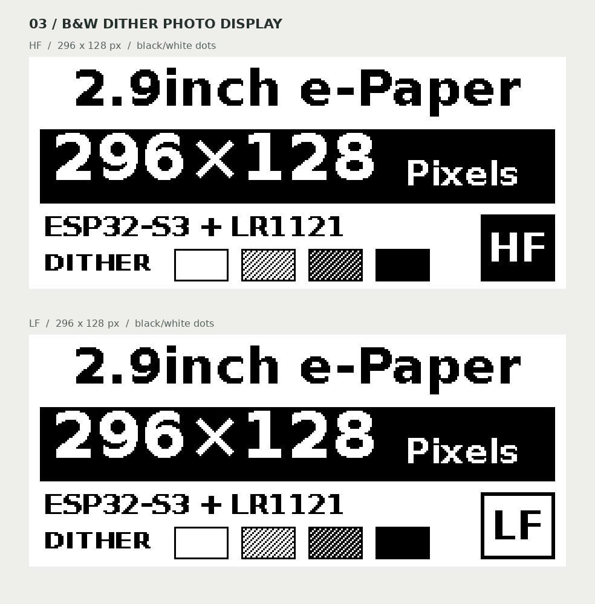

# 03 — 电子纸功能测试与拍照展示

默认仍为客户使用的电子纸功能示例：显示状态与更新计数，每 30 秒更新一次，
沿用一次 FULL 后十次 FAST 的刷新策略。新建配置不会启用拍照模式。

拍照页面采用大号 `2.9inch e-Paper` 标题、反白 `296×128 Pixels`、
`ESP32-S3 + LR1121` 和四级色块。右下角 HF 为黑底白字，LF 为白底黑框。

## 选择模式

在已激活 ESP-IDF 的终端中进入本示例目录，执行（Ubuntu Bash）：

```bash
idf.py menuconfig
```

进入 `03 e-Paper display → Display mode`：

| 选项 | 行为 |
| --- | --- |
| `Functional (customer default)` | 原功能，定时更新计数 |
| `Photo display - HF` | HF 静态拍照画面 |
| `Photo display - LF` | LF 静态拍照画面 |
| `Clear screen (full white, then sleep)` | 启动后全刷为纯白屏，然后让屏幕休眠，保持空白 |

清屏模式每次启动执行一次，不显示文字，也不定时刷新。串口输出
`screen cleared to white; panel sleeping; periodic refresh disabled` 表示清屏完成。
此模式使用普通黑白全刷，不需要选择 HF/LF 或四灰度面板波形。
恢复功能界面或拍照界面时，重新选择对应模式、编译并烧录。

选择 HF/LF 后，还需要在 `Photo gray rendering` 选择显示方式：

| 选项 | 适用条件 | 屏幕标注 |
| --- | --- | --- |
| `B/W dither (compatible; simulated gray using dots)` | 默认兼容路径，使用原有黑白驱动，以网点模拟四级明暗 | `DITHER` |
| `Native 4-gray - Waveshare 2.9inch V2 (verify panel)` | 仅适用于与微雪官方 2.9inch V2 Gray4 波形匹配的面板 | `4 GRAY` |

**面板具体料号尚未由本项目资料确认。** 296×128 分辨率及 SSD16xx 控制器系列
不能单独证明波形兼容性。原生模式不会自动检测型号；应根据屏幕料号确认匹配，
并实测四个色块的方向、均匀度及浅灰/深灰区分。兼容网点显示不等于原生四灰度。

保存后执行（Ubuntu Bash）：

```bash
idf.py build
idf.py -p /dev/ttyACM0 flash monitor
```

串口设备需按实际连接替换。串口首先打印 `photo v2: HF/LF / ...` 说明所选图案与
显示方式，刷新成功后打印 `photo screen shown; periodic refresh disabled`。
拍照模式没有周期性屏幕更新，不启动无线收发或虚构实时数据。
HF/LF 是手动选择的图案标签，不检测射频硬件，也不配置频率。

**交付客户前，切回 `Functional (customer default)` 并重新编译。**
模式保存在本地 `sdkconfig` 中；重启设备或重复编译不会恢复默认。
客户默认固件不包含宣传位图和四灰度波形。

## 原生四灰度预览


原始图为 `preview/photo_hf_4gray.png`、`preview/photo_lf_4gray.png`。
其灰阶值固定为 0、85、170、255；真实面板灰阶反射率不保证与电脑预览一致。

## 黑白兼容预览



原始图为 `preview/photo_hf.png`、`preview/photo_lf.png`。
它们是 1-bit 黑白图，浅灰和深灰分别使用不同密度的网点。
组合预览均按整数倍放大，图案不包含防锯齿产生的额外灰阶。

## 实现与图案维护

- 原生模式使用 9,472 字节的 2-bit 图案，沿用原有坐标映射 `(x,y) → (y,295-x)`，
  转为原生 128×296 方向，分别写入 `0x24` / `0x26` 两个 RAM 平面。
- 原生初始化、159 字节 Gray4 波形和像素编码来自
  [微雪官方 EPD_2in9_V2.c](https://github.com/waveshareteam/e-Paper/blob/e4bb8924d47c8ac88072cdddea5544e2f4314d92/RaspberryPi_JetsonNano/c/lib/e-Paper/EPD_2in9_V2.c)。
  源文件保留原许可，SPI 错误会返回，新增灰度路径的 BUSY 等待限时 15 秒。
- 四灰度路径与原有黑白刷新路径分开。原生画面更新后让控制器休眠并关闭屏幕电源，
  下一次 `board_epaper_start()` 会重新初始化黑白模式，避免残留波形进入 FAST 刷新。
- 灰度适配器仅用于本示例已明确命名的面板配置；不修改通用 SSD16xx 面板注册项、
  黑白帧缓冲格式或其他示例的驱动。这是拍照功能的本地适配，不表示通用组件已支持四灰度。
- 兼容模式仍通过 LVGL 显示 4,736 字节的单色图案及 8 字节调色板。

修改 `tools/render_photo.py` 后执行（Ubuntu Bash，需要 Pillow 与 DejaVu Sans 字体）：

```bash
python3 tools/render_photo.py
```

脚本同时生成预览和 `main/photo_*.inc`。正常固件编译使用已生成的位图，
不需要 Python 图像库或桌面字体。

## 验证

Ubuntu Bash（图像检查需要 Pillow，主机驱动测试需要 C 编译器）：

```bash
python3 tests/test_photo_assets.py
python3 tests/test_gray4_driver.py
cc -std=c11 -Wall -Wextra -Werror tests/test_gray4_encoder.c -o /tmp/test_gray4_encoder
/tmp/test_gray4_encoder
```

检查内容包括图像打包与旋转逐像素一致、网点密度、两个 RAM 平面的全部 65,536 种
八像素输入编码，以及模拟 SPI 下的命令顺序、每个传输故障、BUSY 超时和参数检查。
这些测试不替代真实面板验证。

本次编译验证覆盖 ESP-IDF v5.5.5 下的默认功能、HF/LF 网点、HF/LF 原生四灰度
共五种配置；现有 ESP-IDF 6.2 开发环境也通过了 LF 原生四灰度构建。
5.5.5 验证解析到 LVGL 9.6.0~1。默认固件已检查不包含图案和 Gray4 LUT；
原生 LF 固件已检查仅包含所选图案。上述结果均不代表已经烧录或完成面板适配验证。

板级生成配置省略了值为零的 `dma_burst_size` 初始化项，使 ESP-IDF 5.5 也能编译；
支持此字段的版本仍使用 C 静态初始化的零值。重新运行板级代码生成器时需保留此兼容性。

本示例的硬件验证仍待实板完成；Arduino 示例不受此次修改影响。
